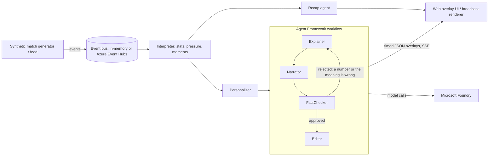

# Inside the Game

Synthetic football events -> explainable, personalised match intelligence.
Built for the Microsoft x Premier League "Inside the Game" hackathon.

## Try it

* **Live demo:** https://itg-app.bravecoast-6297858c.westus3.azurecontainerapps.io (it scales to zero when idle, so the
  first load can take up to ~40 s while it wakes up).
* **Demo video (under 2 minutes):** https://www.youtube.com/watch?v=fjOnWoKb0y0
* **Run it locally (no account or key needed):**

  ```bash
  git clone https://github.com/izzatonline/inside-the-game-ai.git && cd inside-the-game-ai
  python3 -m venv .venv && . .venv/bin/activate
  pip install --upgrade pip && pip install -e ".[dev]"
  ./run.sh --offline   # then open http://localhost:8000
  ```

* **Measured on 202 live AI cards** (gpt-5-mini on Microsoft Foundry, English/Spanish/French, [`docs/evaluation.md`](docs/evaluation.md)):
  91% approved by the FactChecker first time, the other 9% after it sent them back for a rewrite, 0 template fallbacks,
  0 numbers aired that were not in the facts, 0 goal cards aired with a wrong meaning, 3.9 s median from moment to card.

All matches, clubs, players and stadiums are synthetic and fictional.

Pipeline (maps 1:1 to the rules' five stages):

| Stage | Code |
|---|---|
| Ingest | `generator.py` (seeded synthetic match, JSONL export) |
| Interpret | `state.py` (rolling stats, pressure share/momentum, moment detection) |
| Explain | `agents.ExplainerAgent` (why it matters: momentum, control vs chaos) |
| Render | `server.py` timed JSON overlays over SSE + the React pitch and timeline in `frontend/` |
| Personalize | `agents.PersonalizerAgent` (mode, language, club, player focus, metric) |

Guardrail and review loop: the `FactChecker` checks every number in the AI's text against the moment's facts, and checks
the meaning of goal and VAR cards (a goal reads as a goal, "level" only when level, the leading team is named correctly,
own goals name the right team, a VAR check never claims a goal). A draft that fails goes back to the agent that wrote it
(Explainer or Narrator) with the problems listed, for up to two rewrites; only then does that part fall back to a
grounded template. A failed model call is retried once. The
`Editor` decides how the approved card airs (screen slot, priority, time on screen). Every step is recorded and shown
in the card's "How this was made" panel.
With no Azure config the whole app runs offline (templates in en/es/ms).

## Tactical intelligence (what makes it visual)

The generator emits synthetic **tracking frames** (22 player positions, one frame per second) built from formations,
roles and per-team tactics: players move with their own top speed and acceleration limits, defend as a compact block,
respect offside, and take up real set-piece shapes (zonal corners, free-kick walls at 9.15 m, penalties). Event names
follow the positions (the receiver of a pass is the player the ball reaches). From this tracking the app measures
distance covered, top speed and fast runs, and **Restart Watch** times throw-ins, goal kicks and keeper holds against
the countdowns in the Premier League and Pro Ref Competition Guidance Handbook 2026/27 (5 s, 5 s, 8 s). `tactics.py` then *infers* from settled open-play positions
and events alone, with no access to the generator's labels:
formation (4-3-3, 4-2-3-1), defensive line height, pressing (PPDA-like), width, directness, each player's role
(inverted / overlapping full-back, inside forward, holding midfielder, ...), and counter-options against the opponent.
The UI draws team-shape hulls, a territory-control surface and role badges on a mobile-first pitch.

## Architecture



## Frontend (React + shadcn/ui)

`frontend/` is Vite + React + TypeScript + Tailwind v4 with shadcn/ui components (Tabs, Card, Badge, Sheet, Select,
ToggleGroup, Progress, Tooltip, ScrollArea, Skeleton). The pitch is one canvas component. The build is written to
`src/itg/static` (committed, so `uvicorn` serves the UI without Node).

```bash
cd frontend && npm install --legacy-peer-deps && npm run build   # rebuild after UI changes
npm run dev                                                         # hot reload, proxies /api to :8000
```

## Run

Python 3.9+ for the offline app; 3.10+ for model narration through Agent Framework (3.11 used in development):

```bash
python3 -m venv .venv && . .venv/bin/activate
pip install --upgrade pip && pip install -e ".[dev]"   # an old pip cannot install this project in editable mode
./run.sh --offline                       # grounded template wording, no model; open http://localhost:8000
pip install -e ".[azure,agents]"         # optional: model narration through Agent Framework
cp .env.example .env                     # fill in your Foundry / Azure OpenAI deployment, then ./run.sh
python -m pytest -q
PYTHONPATH=src python -m itg.generator --seed 7 --out data/match_7.jsonl   # raw synthetic events as JSONL
```

URL parameters: `match` (coastal, riverside, redcrest), `seed`, `speed`, `mode` (casual, analyst), `lang`, `view=2d`,
`ai=0`, `start=<minute>`. The stream keeps one orientation in the data (first team attacks +x); the pitch view turns
second-half frames round so the teams switch ends.

## Microsoft Agent Framework + Foundry

`src/itg/maf.py`: Explainer -> Narrator -> FactChecker -> Editor run as an Agent Framework `Workflow` (Executors +
edges), with a conditional edge from the FactChecker back to the Explainer for rewrites (the steps live in
`agents.Newsroom`, so the plain-Python path behaves identically);
`FoundryLLM` turns each prompt into an `agent_framework.Agent` on a `FoundryChatClient`. Offline (no env) the same
workflow runs with template fallbacks; `/api/config` reports `orchestration` and `llm`.

```bash
az login
export FOUNDRY_PROJECT_ENDPOINT="https://<project>.services.ai.azure.com"
export FOUNDRY_MODEL="<deployment name>"
```

**Verified live (2026-10-21):** a `gpt-5-mini` deployment in a Microsoft Foundry project, called through the Azure OpenAI
endpoint (`AZURE_OPENAI_ENDPOINT`, `AZURE_OPENAI_DEPLOYMENT`, `AZURE_OPENAI_API_KEY` in `.env`; see `.env.example`); the Agent
Framework workflow orchestrates the agents. The `FOUNDRY_PROJECT_ENDPOINT` / `FoundryChatClient` path above is implemented
but not yet exercised.

## Azure cloud-native

* `bus.py` / `publisher.py`: event-driven ingest. Default is an in-memory bus; `ITG_INGEST=eventhubs` consumes from
  Azure Event Hubs (Entra ID auth, no connection strings). `/api/live` is the viewer endpoint on the shared bus;
  late joiners are caught up silently, then get live overlays.
* `Dockerfile` + `infra/main.bicep` + `infra/deploy.sh`: **deployed** to Azure Container Apps (scale to zero, up to 2
  replicas), image in Azure Container Registry, Log Analytics. Keyless: a user-assigned managed identity pulls the image
  and holds the Cognitive Services OpenAI User and Speech User roles on the Foundry resource, so no keys live in the cloud.
  `ITG_MAX_MODEL_CALLS_PER_HOUR` caps model calls on the public demo (over the cap, grounded templates).
  Live: https://itg-app.bravecoast-6297858c.westus3.azurecontainerapps.io
  Deploy or update: `infra/deploy.sh <resource-group> <foundry-account> <model-deployment>` (needs `az login` and Docker).
* `speech.py`: the full-time recap is read aloud by an Azure AI Speech neural voice in the viewer's language
  ("Listen to the recap"); only recaps the server wrote can be spoken.
* Event Hubs ingest (`ITG_INGEST=eventhubs`) is implemented but not part of the deployment.
* `python -m itg.demo`: multi-agent trace with handoffs, a simulated model outage, a model that keeps inventing numbers
  (two rewrites refused, then grounded templates) and one that fixes its draft after the FactChecker's feedback.
* `scripts/eval_agents.py`: runs the live workflow over several matches and languages and writes `docs/evaluation.md`
  (first-pass approval, approval after a rewrite, fallbacks, latency, and an independent re-check of aired numbers).

## Video to tracking (prototype)

The brief mentions "auto-eventing": running a model over a video feed. `src/itg/vision/` is an early, honest prototype of
the first half of that: **fixed-camera footage -> player positions on our pitch**. It does not yet detect passes, shots or
goals from video, and it is not wired into the app UI.

* **Detect:** YOLOv8x at high resolution finds players (and sometimes the ball).
* **Map to the pitch:** a homography from four or more known pitch points (`calib.json`) converts feet positions to the
  same 0-100 pitch coordinates the synthetic generator uses.
* **Track and team:** a ground-plane nearest-neighbour tracker keeps IDs (ByteTrack lost far-away players, whose boxes are
  a few pixels wide); jersey colours are clustered into two teams.
* **Score it:** `vision/synth.py` renders synthetic fixed-camera footage from generator data, so true positions are known.

On a 12 s rendered clip (3200x1000, stick-figure players): about **67% of players found within 3 m, median position error
0.47 m, 93% team-colour accuracy, ~16 of 22 players per frame, but ID fragmentation (45 IDs for 22 players)**. The
detector is weak on the simple figures, and the ball is not tracked. Real footage is harder (panning cameras need per-frame
calibration), and was not tested here for licensing reasons. Only synthetic footage is in this repo.

Clip: [`docs/video-prototype.mp4`](docs/video-prototype.mp4) (top: detections on synthetic footage; bottom: tracked dots vs
ground-truth rings).

```bash
uv pip install -e ".[vision]"
python -m itg.vision.synth videos/synth.mp4 --seconds 12          # render footage + truth + calibration
python -c "from itg.vision.pipeline import track_video as t; t('videos/synth.mp4','videos/synth.calib.json','videos/synth.tracking.json',model='yolov8x.pt',conf=0.05,imgsz=3200)"
python -m itg.vision.score videos/synth.tracking.json videos/synth.truth.json
```

## Status (honest)

Verified: generator, interpreter, personalisation, Agent Framework workflow, live Foundry model calls (gpt-5-mini), template fallback, SSE UI, tests.
Prototype only: video-to-tracking (synthetic footage). Not yet verified live: `FoundryChatClient` path, Event Hubs ingest. Verified live (2026-10-23): Container Apps deployment with managed identity to Foundry and Azure AI Speech.
All data is synthetic; team and player names are fictional. License: MIT.
