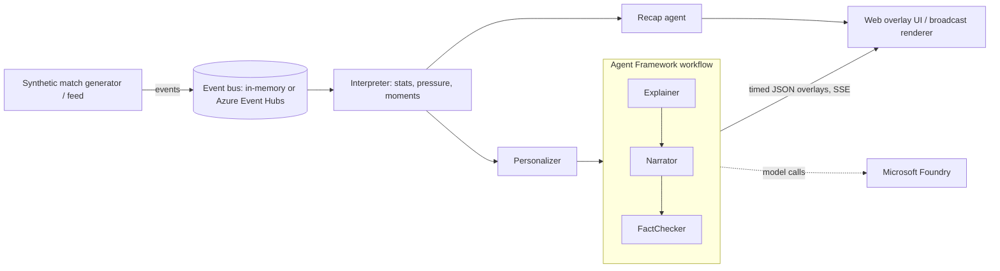

# Inside the Game

Synthetic football events -> explainable, personalised match intelligence.
Built for the Microsoft x Premier League "Inside the Game" hackathon (deadline 2026-10-27, 11:59 PM PT).

Pipeline (maps 1:1 to the rules' five stages):

| Stage | Code |
|---|---|
| Ingest | `generator.py` (seeded synthetic match, JSONL export) |
| Interpret | `state.py` (rolling stats, pressure share/momentum, moment detection) |
| Explain | `agents.ExplainerAgent` (why it matters: momentum, control vs chaos) |
| Render | `server.py` SSE + `web/index.html` overlay |
| Personalize | `agents.PersonalizerAgent` (mode, language, club, player focus, metric) |

Guardrail: `FactChecker` rejects any LLM text containing numbers not in the source facts, then falls back to templates.
With no Azure config the whole app runs offline (templates in en/es/ms).

## Tactical intelligence (what makes it visual)

The generator emits synthetic **tracking frames** (22 player positions per event) built from formations, roles and
per-team tactics. `tactics.py` then *infers* from positions and events alone, with no access to the generator's labels:
formation (4-3-3, 4-2-3-1), defensive line height, pressing (PPDA-like), width, directness, each player's role
(inverted / overlapping full-back, inside forward, holding midfielder, ...), and counter-options against the opponent.
The UI draws team-shape hulls, a territory-control surface and role badges on a mobile-first pitch.

## Architecture



## Frontend (React + shadcn/ui)

`frontend/` is Vite + React + TypeScript + Tailwind v4 with shadcn/ui components (Tabs, Card, Badge, Sheet, Select,
ToggleGroup, Progress, Tooltip, ScrollArea, Skeleton). The pitch is one canvas component. The build is written to
`src/itg/static` (committed, so `uvicorn` serves the UI without Node).

```bash
cd frontend && npm install --legacy-peer-deps && npm run build   # rebuild after UI changes
npm run dev                                                         # hot reload, proxies /api to :8000
```

## Run

Python 3.11 (uv is installed in `.venv`; the 3.11 env is `.venv311`):

```bash
PYTHONPATH=src .venv311/bin/uvicorn itg.server:app --port 8000   # open http://localhost:8000
.venv311/bin/python -m pytest -q
PYTHONPATH=src .venv311/bin/python -m itg.generator --seed 7 --out data/match_7.jsonl
```

## Microsoft Agent Framework + Foundry

`src/itg/maf.py`: Explainer -> Narrator -> FactChecker run as an Agent Framework `Workflow` (Executors + edges);
`FoundryLLM` turns each prompt into an `agent_framework.Agent` on a `FoundryChatClient`. Offline (no env) the same
workflow runs with template fallbacks; `/api/config` reports `orchestration` and `llm`.

```bash
az login
export FOUNDRY_PROJECT_ENDPOINT="https://<project>.services.ai.azure.com"
export FOUNDRY_MODEL="<deployment name>"
```

Not yet verified against a live Foundry project (no credentials here). Azure OpenAI vars in `.env.example` remain a fallback.

## Azure cloud-native

* `bus.py` / `publisher.py`: event-driven ingest. Default is an in-memory bus; `ITG_INGEST=eventhubs` consumes from
  Azure Event Hubs (Entra ID auth, no connection strings). `/api/live` is the viewer endpoint on the shared bus;
  late joiners are caught up silently, then get live overlays.
* `Dockerfile` + `infra/main.bicep` + `infra/deploy.sh`: Azure Container Apps (managed identity, Log Analytics,
  HTTP autoscale 1-3), Event Hubs namespace with local auth disabled, ACR pull. **Draft: not built or deployed yet**
  (no Docker daemon / `az` / `bicep` on this machine).
* `python -m itg.demo`: multi-agent trace with handoffs, a simulated model outage and a hallucinating model; the
  FactChecker rejects ungrounded numbers and the pipeline degrades to grounded templates.

## Status (honest)

Verified locally: generator, interpreter, personalisation, Agent Framework workflow (offline templates), SSE UI, tests.
Not yet verified live: Foundry model calls, Event Hubs ingest, Container Apps deployment.
All data is synthetic; team and player names are fictional. License: MIT.
